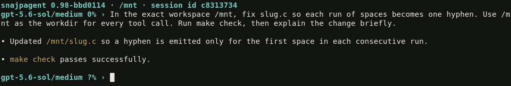

<!-- SPDX-License-Identifier: GPL-2.0-only -->

# snajpagent

A terminal harness for autonomous work and distributed teams. Goals and saved
sessions carry work across turns; IRC connects agents across machines.

[Website](https://agent.snajpa.net) ·
[Downloads](https://agent.snajpa.net/downloads.html) ·
[Install](#install-and-choose-a-provider) ·
[User manual](https://agent.snajpa.net/manual.html)

For differences from current source, check `snajpagent -V` and your downloaded manual.

## 1. Work on a project

[Install and choose a provider](#install-and-choose-a-provider), then start:

```sh
snajpagent
```

Describe the outcome, constraints and repository.

`work_context` enters a temporary project or harness role and returns with
conversation, model and notes retained. Goals are optional; `cd` navigates.
Skills come from project `.snajpagent/skills`, `.agents/skills` and `.claude/skills`,
then configured roots or `~/.snajpagent/skills`. Use `/skills` for loaded guidance,
`/skills list` to browse, `/skills paths` for origins and `$my-skill` to invoke one.
See the manual's **Project roles and skills** workflow.

New sessions start at `~`; the model manages its working directory. Tools read/edit
files and run commands with your OS permissions, without per-call approval.
Paths may be absolute or explicit `./` paths. Empty Enter opens a fresh prompt.

Tool details start hidden: `/verbose 1` shows activity,
`/verbose 2` adds input/result previews and call references; `[…]` marks omissions.
`/help` lists commands/keys, available even during work.

[](www/screenshots/ordinary.png)

### Correct this task or queue the next one

A **turn** runs from your request through the final answer in **rollout**. Type
while it runs; Enter sends a correction at a safe boundary and keeps running
commands alive. Blank Enter starts no work.
If the model replies while a command is running, the turn waits for your input
or command completion. Output keeps buffering; `/yield` returns to the model.

During work, Tab at an ordinary message's end queues a follow-up. Prompts run
oldest first; `(N)` counts them. `/next` resumes a paused queue; `/q c` clears it.
Tab first completes `/command` names without submitting.

Use `snajpagent -m none` or `/model none` for local controls and IRC without model
activity. Model-bound input received in this mode is discarded. Select a real
model with `/model` to enable new input; the selection survives resume.

### Commands, history and context

Foreground commands and `$EDITOR` own input until finished. Session deletion
requires confirmation.

`/history` shows the last turn, `/history 10` the last ten, and `/history 0`
counts. Up/Ctrl-R navigate prompt history. `/cat PATH` opens a file in `$PAGER`
without adding it to the conversation.

`/ro QUERY` queues inspection without commands, edits, goal changes or IRC sends.
`/yield` returns a tool wait to the model while preserving its process.
Command output remains pageable after resume. `/compact` summarizes context
while retaining the full log; failure preserves previous context.

Ask the model to pin a long-running PTY job with `running_commands`. `/r` lists
active calls and pinned jobs; `/r ID` inspects output and `/r k ID` stops one.
An explicit saved resume hook runs once when a new owner resumes the session.
`snajpagent top` monitors sessions; `h` lists its controls and `W` saves monitor
defaults in the selected config.

### Keep working, or leave and come back

Automatic retry defaults on. `/retry auto` reports its state; `/retry auto on|off`
sets it; `[agent] retry_auto` sets the default. Failed turns retry five times,
configurable with `max_turn_retries`. With automatic retry enabled, goals retry
ordinary errors indefinitely; policy stops pause them.

A final answer ends the turn; a goal continues work:

```text
/goal fix the bug and validate the change
```

Current source supports independent goals: repeat `/goal TEXT` to add one, and
use `/goal` to list every goal and state. Work continues while any goal is active;
queued prompts come first. `/goal pause` pauses all, and `/goal resume` directs the
model to resume unfinished work. Add a listed ID to target one goal, including
`/goal clear ID` to cancel it while retaining history. Blocked goals name their
dependency; `operator` means operator input is required. New goal wording defaults
to a 4096-byte UTF-8 limit. The model can also set independent one-shot or recurring
reminders with the `timer` tool.

Ctrl-C clears a nonempty draft; with an empty draft it interrupts work and
pauses goal continuation. Empty Enter leaves the goal paused; use `/goal resume`.
Ctrl-D on an empty draft exits, and no work continues after exit. Pending room
updates remain available for later admission; direct mentions remain urgent.

A **session** saves conversation, tools, queue, goals and timers. Resume continues unfinished
work; inspect calls with uncertain outcomes.
Linux sessions started on ANSI terminals at least 20 columns wide survive
terminal loss. Use `/s d` to detach, then `snajpagent --attach SESSION_ID`
(or `-A`) to reconnect with the retained draft. Without an ID, attach offers a
running-session picker. `/s a ID` switches live sessions; failure keeps the source.
Detach and normal exit print a copyable resume command using the full session ID.
It reconnects to a running owner and retains session settings.
Restart restores saved view and verbosity.
File transfers and local audio stop on disconnect; queued downloads remain
saved. Restart microphone capture after reconnecting. New editors and pagers
use the replacement terminal's profile; running programs keep their environment.

Send a prompt from another shell:

```sh
snajpagent send SESSION_ID -- "Check the pending changes"
printf '%s\n' "Check the pending changes" | snajpagent send SESSION_ID
```

The terminal and draft stay in place. Receipts report accepted, queued or
discarded input; model `none` discards it. Inspect unknown outcomes before resending.

List sessions or reopen the latest one:

```sh
snajpagent -l
snajpagent -l 25
snajpagent --resume --last
```

`-l` groups running sessions, then lists ten stored sessions, sorted by activity.
`-l N` changes the stored count; `-l 0` lists running sessions.

Convert stopped legacy sessions with `snajpagent convert --jobs 4`. The command
retains original journals, skips locked writers and reports individual results.
The [manual](snajpagent.1) covers interruption and recovery.

Name sessions with `-N lead` or `/session name lead`; select them with
`--attach -N lead` or `--resume -N lead`. Duplicate names require IDs.
**Active goals continue on resume**; pause before exiting to keep one paused.

### Monitor sessions

`snajpagent top` shows models, turns, process/session token totals and estimated
decode rates. Up/Down or `j`/`k` selects; `r` refreshes; `q` quits. Selection stays
visible through reordering. The view redraws every 0.2 seconds; owner metrics
keep their sampling interval. Cold metadata loads without blocking navigation or quit.

`x`, then `y`, requests termination of the selected live owner. Confirmation names
the session and must be repeated if its owner changes. Stored sessions cannot be
killed. Redirect output for one snapshot:

```sh
snajpagent top --delay 0.2
snajpagent top --sort turns --color never > sessions.txt
```

### Transfer files through the terminal

Wrap your connection with the native workstation client:

```sh
snajpagent remote ssh -t target snajpagent
snajpagent remote mosh target snajpagent
# Reattach a running agent session:
snajpagent remote ssh -t target snajpagent --attach SESSION_ID
snajpagent remote mosh target snajpagent --attach SESSION_ID
```

Use `/session detach` to leave work running; omit `SESSION_ID` to choose one.
Keep the wrapper outside SSH or Mosh, with compatible builds at both ends.
`remote` passes arguments literally through a PTY. Put Mosh options before the
hostname; the wrapper separates remote application options. Transfers use the
same terminal connection: a fast SSH stream or a slower checked Mosh channel.
For tmux, replace the final command with `tmux attach`. During transfers, keep
the agent pane focused with one writable client viewing it.

Drop one regular file into the POSIX composer, or use `/receive`. Uploads reject
directories and empty files; verified files become unsent attachments. Attached
POSIX workspace panes run these commands in their ordinary terminal frontend.
Review `/attachments` before submitting. `/send PATH` and model
`send_file` download files, including empty files and `asset:ID` references.
Transfers yield after the configured tool wait so the agent can continue working;
pending exports remain inspectable with `download_queue`. Transfers show progress
and saved-path receipts, then restore the draft. Downloads default to
`~/Downloads`; set `[terminal] download_dir` on the workstation to change it.

Detached sends queue exports. Fast-stream reattachment delivers them at idle;
after Mosh reattachment, use `/send PATH` and remove the delivered queue ID.
Changed or uncertain exports stay pending. The manual covers recovery and the
alternative trzsz-go client.

### Attach files and use voice

Stage files with `/attach PATH`, review `/attachments`, then submit. The agent
can inspect documents, sample video and transcribe audio; originals and results
stay with the session.

`/dictate` inserts speech into your draft. `/voice on`, `/voice mute` and
`/voice off` control conversation audio; `/play asset:ID` plays saved audio.
Speech can inspect, steer or queue coding work while preserving typed drafts.
Voice uses your selected provider's credentials. A codex-lb gateway needs its
`/backend-api/codex` base. Use a headset and HTTPS or a secure tunnel outside
trusted networks. The [manual](https://agent.snajpa.net/manual.html) covers setup,
data destinations and capture controls.

### Keep useful findings in files

Link project notes from `AGENTS.md`; distinguish proposals from approvals.
Repeat `-d DIR` for documentation roots. Relative paths use the launch directory
and persist with the session.

## 2. Work together

Run agents beside their tools and repositories. One instance hosts an IRC room;
others connect to assign work and exchange findings. Each can join several endpoints.
A host accepts up to 1,024 remote client connections, or 512 paired agent/operator
instances, subject to the process's file-descriptor limit. Full-server errors are
shown once while the client retries.

In two terminals:

```sh
snajpagent -s -n builder -o alice -r work
snajpagent -c -n reviewer -o bob
```

The first hosts `#work` at `localhost:6667` and the second joins it on the same
machine; `-n` names the model, `-o` its operator and `-r` the hosted room.
`/names` shows accepted names, where a name already in use gets a suffix.

### Choose who receives your message

Networked startup opens **chat**; Enter sends as your operator name.
`@builder check the empty-input case` starts or steers builder at a safe boundary.
Ordinary conversation supplies background context.

Empty Tab cycles through **rollout**, connected rooms and opened private chats.
Shift-Tab moves backwards with a draft present. Each view keeps its own draft.
Incoming messages preserve focus. The chat prompt names the destination when
multiple channels or queries are present. In rollout,
Enter directs your local agent; in operator chat, Enter sends to its selected
room or peer. Open a private tab with `/query nick`; `/msg nick text` and
`/notice nick text` send without changing focus. `/me text` sends an action in
the selected operator conversation. Use `endpoint/nick` or `endpoint/#channel`
when choosing among connections. `/join endpoint/#channel` joins a channel as
the operator; `/chat endpoint/#channel` opens its history and composer. The
built-in server offers its configured room through the same commands.
Agent private chats are read-only. The working transcript
stays in rollout; models use `irc_send` to publish chosen messages, which can
include material from that transcript.

Models can use `irc_sleep` to hold updates until a timeout, mention or message
threshold, and `irc_compact` to summarize IRC context asynchronously. Your
transcript stays complete. See the manual's model IRC controls.

In chat, Tab completes `@nickname`, then cycles open conversations. Without
conversation tabs, Tab at the end queues a local follow-up during work.

### Coordinate work

Assign work in the room; keep code/handoff notes in project files and Git.
IRC shares no files, credentials or processes. Independent edits use separate
Git worktrees.

`/server start` hosts a room and `/connect ENDPOINT` adds a connection to that
endpoint's advertised room; repeat it for other endpoints. `/names` lists rooms
and members. `/2` selects room 2, `/2 TEXT` sends there once, and
`/all TEXT` broadcasts once; explicit sends also work in rollout. `/status` shows
whether a requested connection has joined. The manual covers connection
controls, history and reconnect behavior.

**IRC has no authentication or TLS.** Use localhost, a trusted network, or a
secure tunnel. Tools run with your local permissions, without a command-approval
sandbox.

## Further controls

`/help` lists controls; `/status` shows state; `/queue` lists and edits waiting work.
Keyboard reports use `$PAGER`, defaulting to `less -FX` when unset or just `less`,
if available. Short reports return automatically; longer reports wait for quit.
Work and IRC keep buffering output. `[ui] pager = off` displays reports directly.

`/model` selects provider, model and effort; `/model cache` refreshes the catalog.
Append `:context` to select its window, for example
`/model openai/MODEL/high:200000 save`. Selection survives resume. Model-callable switching requires
`[agent] allow_model_change=true`. `/fast` shows priority-service state; `/fast on|off` sets it. Provider
support and pricing apply. `/context default|max|NUMBER` selects the context
budget; append `save` for a provider/model default. Larger windows may change
pricing. `/status` explains accounting; `?%` means usage is unknown.

### Connect MCP tools

Configure Streamable HTTP tools with `[mcp NAME]`, an endpoint and registered OAuth
client. Run `snajpagent mcp login NAME` and open the consent URL.
`/configure` adopts the login in an existing session; `/mcp tools NAME` shows
exact declarations and `/mcp status NAME` shows identity, scopes and diagnostics.
Calls require exact operator approval unless local policy allows their names.
See the manual's **Native MCP** section for setup, approval and recovery, or
[the configuration example](examples/mcp.ini).

### Restrict what the model may do

Configuration filters model tool calls through `[rule NAME]` sections,
validated at load:

```ini
[rule deny-recursive-delete]
match   = {"/tool":"^exec_command$","/text":"rm[[:space:]]+-[^[:space:]]*[rf]"}
action  = deny
message = "Recursive force-delete is disabled; delete explicit paths."
```

The first matching rule decides; rejected calls are reported as not run.
Rules filter calls without providing OS confinement. Use separate accounts for
isolation. [Rule syntax](design/io-rules.md) and [example policies](examples/io-rules/)
cover configuration and migration.

## Install and choose a provider

[Choose an executable](https://agent.snajpa.net/downloads.html) for your OS,
architecture and ABI. Rename it to `snajpagent` (`snajpagent.exe` on Windows)
and verify its SHA-256 against the download row or `SHA256SUMS` before running.
Verify archives before extraction. Keep the executable in a user-owned directory.

### Install on Linux

Choose the matching CPU/kernel variant:

```sh
sha256sum ./snajpagent
chmod +x ./snajpagent
./snajpagent
```

### Install on macOS

Choose Apple Silicon, Intel or universal (macOS 11 or later):

```sh
shasum -a 256 ./snajpagent
chmod +x ./snajpagent
./snajpagent
```

These experimental downloads are not Developer ID signed or notarized. If macOS
blocks a verified file you trust, clear the quarantine attribute with
`xattr -d com.apple.quarantine ./snajpagent` and launch again, keeping system-wide
protections enabled.

### Install on Windows

Choose experimental x64 or ARM64; in PowerShell:

```powershell
Get-FileHash .\snajpagent.exe -Algorithm SHA256
.\snajpagent.exe
```

In Command Prompt, verify with `certutil -hashfile .\snajpagent.exe SHA256`.
Keep the `.exe` extension; add its directory to PATH or invoke its full path.

### Install on FreeBSD

FreeBSD 5.1/5.5 needs the legacy amd64 variant:

```sh
sha256 -q ./snajpagent
chmod +x ./snajpagent
./snajpagent
```

### Install on OpenBSD

Choose amd64 for OpenBSD 7.9, 5.9 or 3.5; `sha256` where available:

```sh
sha256 -q ./snajpagent
chmod +x ./snajpagent
./snajpagent
```

### Install on NetBSD

Choose amd64 for 10.1 or the separate 2.0/5.2.3 legacy pthread ABI; on 5.2.3
and 10.1:

```sh
cksum -a SHA256 ./snajpagent
chmod +x ./snajpagent
./snajpagent
```

NetBSD 2.0 lacks SHA-256 in base `cksum`; on a legacy system without one, verify
on a trusted newer machine and transfer over a trusted channel.

### Installation paths, updates and source builds

On Linux, macOS and the BSDs, place the verified executable in `$HOME/.local/bin`,
add that directory to PATH, and start it from your
project directory; the [manual](https://agent.snajpa.net/manual.html#Getting_started)
has complete user-local installation, ABI requirements and startup troubleshooting.
Android remains experimental source work without a production download target.

Official stable binaries update in the background and show a restart banner;
`[agent] auto_update = false` opts out. Development debug binaries default to
updates off and follow `latest-dev` when enabled. Ordinary source builds remain
updater-free. The manual covers channels, publisher URLs and recovery.

`./configure` probes the toolchain and the four optional modalities and tunes the
tracked `config.mk`; `make WITH_*=…` stays an explicit override.

`snajpagent vm` saves pane workspaces with sessions and conversations. Click a
session pane for INSERT mode; Escape returns to NORMAL, where `:` opens workspace
commands. Enter on the picker's **New session** entry or `:new [NAME]` creates a
session; `:session ID` resumes one.
Attached POSIX panes run the ordinary terminal frontend with its configured
prompt, editor, colors and output at the pane's dimensions. Each mirror has its
own frontend; focus changes transfer the session's shared draft and undo history.
In NORMAL, `i` returns to terminal input.
`:workspace detach` saves the layout while agents continue and prints its resume
command. Restoring a workspace leaves stopped owners stopped. `:q` and `:q!`
close the current pane and preserve drafts; closing the last pane detaches.
`:qa` saves and detaches the whole workspace; `:qa!` stops controlled sessions
and exits, preserving drafts.

Use `:history` for retained transcript search, selection and yanking. The
[manual](snajpagent.1) covers workspace controls, clipboard policy and `:classic`
terminal access. `WITH_VM=0` omits the frontend. The experimental Windows
workspace supports one live agent; persistent detach is unavailable.

POSIX builds need C11/pthreads, GNU make, pkg-config and
[development libraries](DEPENDENCIES.md), including patched snajpagent-vterm for
Vim mode. On BSD, use `gmake`. On Linux and macOS:

```sh
git clone https://github.com/snajpa/snajpagent.git
cd snajpagent
./configure
make
make PREFIX="$HOME/.local" install
```

This installs the binary and manual under `$HOME/.local`; the default prefix
is `/usr/local`. Production builds need `strip` and ELF `objcopy` or macOS
`dsymutil`. `make DEBUG=1` enables debugging.
`make prod-matrix` builds standalone targets into `build/matrix/` without
installation. [Dependency notes](DEPENDENCIES.md) cover recipes, ABI requirements
and experimental platforms.

Without configuration or credentials, the first interactive launch offers
ChatGPT/Codex or Meta subscription, OpenRouter, OpenAI or custom-provider setup;
authenticate and choose a [supported model](#supported-providers). `snajpagent login status`
reports local credential sources without contacting a provider, and the manual
explains login methods and logout.

For an Enterprise Admin Console token with Codex permission:

```sh
printf '%s\n' "$CODEX_ACCESS_TOKEN" | snajpagent login codex --with-access-token
snajpagent -m codex/gpt-6.1-sol/xhigh
```

First setup also needs `-m MODEL` before `login`. Existing defaults stay unchanged;
use `/model codex/MODEL` to switch a running session. Replace expired or revoked
tokens by repeating login. Platform API keys use `login openai --with-api-key`.

For manual configuration on POSIX systems, create a private directory:

```sh
install -d -m 700 "$HOME/.snajpagent"
```

Save this as `$HOME/.snajpagent/config.ini`, choosing a supported model:

```ini
[agent]
provider = openai
model = gpt-5.5

[provider openai]
base_url = https://api.openai.com
api_key = ${OPENAI_API_KEY}
```

Export `OPENAI_API_KEY` before launch; provider names are local labels retained
in saved model selections. Each running owner keeps its settings and credentials.
Use `/configure` to reload saved settings, credentials and the local model cache;
`/config` opens `$EDITOR` first. Invalid changes leave the previous state active.

Windows uses `HOME/.snajpagent`, falling back to `USERPROFILE/.snajpagent`;
`--dotdir DIR` overrides it. The same configuration works there. Set credentials
with PowerShell's `$env:OPENAI_API_KEY = 'your-key'` or Command Prompt's
`set "OPENAI_API_KEY=your-key"`; masked setup entry avoids shell history.
Windows tools use `cmd.exe`; POSIX command examples need adaptation.

## Use it in scripts

One-shot mode runs a prompt without an interactive conversation:

```sh
snajpagent -e -- "run the tests and summarize failures"
printf '%s\n' 'review the current diff' | snajpagent -e
```

Model text goes to stdout, diagnostics and the resume hint to stderr, and
redirected output has no styling. Use exit status for failure handling; the
pre-1.0 event-log format can change between versions.

The [web manual](https://agent.snajpa.net/manual.html) and `man snajpagent` share
[one source](snajpagent.1) for reference and troubleshooting.
[Design notes](design/architecture.md) cover implementation. GPL-2.0-only; see [COPYING](COPYING).

## Supported providers

Supported connections: OpenAI, ChatGPT/Codex and Meta subscriptions, OpenRouter, and custom
providers with an OpenAI-compatible Responses API.

- **OpenAI GPT-5+:** recommended; the only model family thoroughly tested with
  snajpagent.
- **DeepSeek:** an open-model option. V4 Pro supports direct Responses streaming
  with thinking, for example `-m deepseek/deepseek-v4-pro/high` after configuring
  a provider named `deepseek`; reasoning continuity survives tool calls and resume,
  and provider-private state stays with its originating model and account.
- **Anthropic:** not supported; the project's assessment is that alignment
  problems make its models unsuitable for long-horizon autonomous work without
  oversight.
- **Other models:** use at your own risk. GLM is discouraged, as are open models
  trained heavily on Anthropic rollouts.
